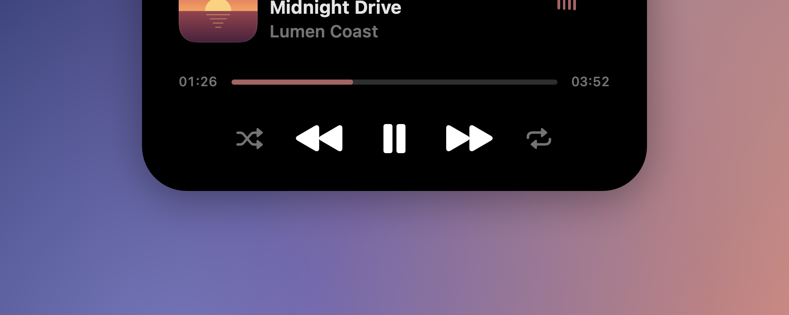

<p align="center">
  <picture>
    <source media="(prefers-color-scheme: dark)" srcset="assets/logo-white.svg">
    
  </picture>
</p>

# NotchNotch

Your Mac's notch, open to extensions. Write one in React and TypeScript, and NotchNotch draws it natively around the camera, as if it came with the Mac: a timer, a build, the next meeting, whatever you need. Or install one from the [Store](https://notchnotch.github.io/store/).

<p align="center">
  
</p>

**Developer preview** for macOS 14 or later. Free and open source.

**[notchnotch.github.io](https://notchnotch.github.io)**: download, documentation and the [Store](https://notchnotch.github.io/store/).

## Features

- **Extensions:** describe the notch with React components; NotchNotch draws them with the system's own controls, and each extension runs in its own process. Live activities beside the camera, announcements, an open view, questions and settings, all in the same shapes.
- **The Store:** extensions reviewed in the open and checked against a signed catalog before they install. Share your own as a `.notchext` file people double-click.
- **Built in:** Music for Spotify and Apple Music, Calendar with a button to join the meeting, Shelf for files you drop on the notch, and the menu bar icons the camera hides.
- **Private:** no account, no analytics. Everything stays on your Mac.

## Build an extension

```sh
npm create notchnotch-extension@latest my-extension
```

Start with [Getting started](docs/extensions/getting-started.md), then browse the [documentation](docs/README.md), also on [the website](https://notchnotch.github.io/docs/).

## Install

1. Download the latest `NotchNotch-<version>.dmg` from [Releases](https://github.com/NotchNotch/notchnotch/releases).
2. Open it and drag **NotchNotch** to **Applications**.
3. Open NotchNotch. This preview isn't notarized by Apple yet, so the first time, open **System Settings › Privacy & Security** and choose **Open Anyway** next to *"NotchNotch" was blocked*.

NotchNotch updates itself after that. See [Using NotchNotch](docs/guide/using-notchnotch.md) to connect Music and Calendar.

## Contributing

Bug reports, ideas and pull requests are welcome. See [Contributing](CONTRIBUTING.md) to build the app, ask questions in [Discussions](https://github.com/NotchNotch/notchnotch/discussions), and report security problems privately as described in [Security](SECURITY.md). Anyone can submit an extension to the Store with `notchnotch publish`. Everyone follows the [code of conduct](CODE_OF_CONDUCT.md).

[Changelog](CHANGELOG.md) · [Privacy](PRIVACY.md) · [Documentation](docs/README.md)

## License

Copyright © 2026 AmirHossein Sadeghi. NotchNotch is licensed under the [GNU GPL v3.0](LICENSE) (GPL-3.0-only).

The extension SDK packages in [`packages/`](packages) (`@notchnotch/sdk`, `@notchnotch/runtime`, `@notchnotch/protocol`, `@notchnotch/react-renderer`, `@notchnotch/cli` and `create-notchnotch-extension`) are licensed under the [MIT License](packages/sdk/LICENSE), so extensions built with them can use any license.
